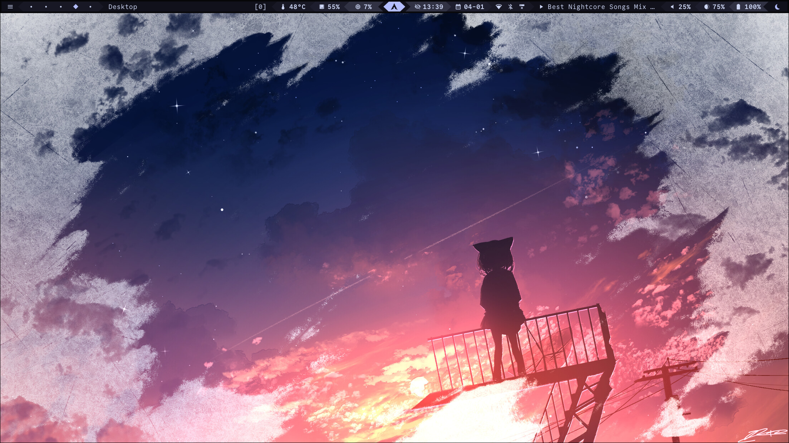
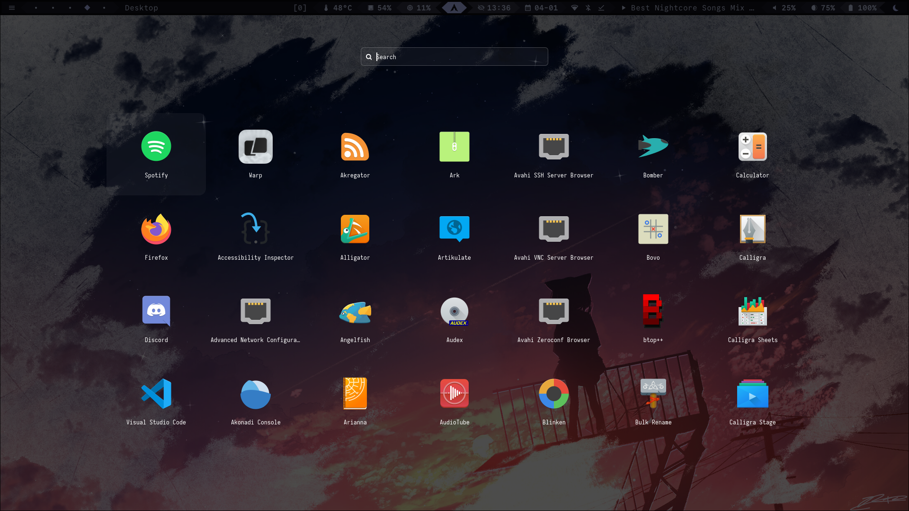
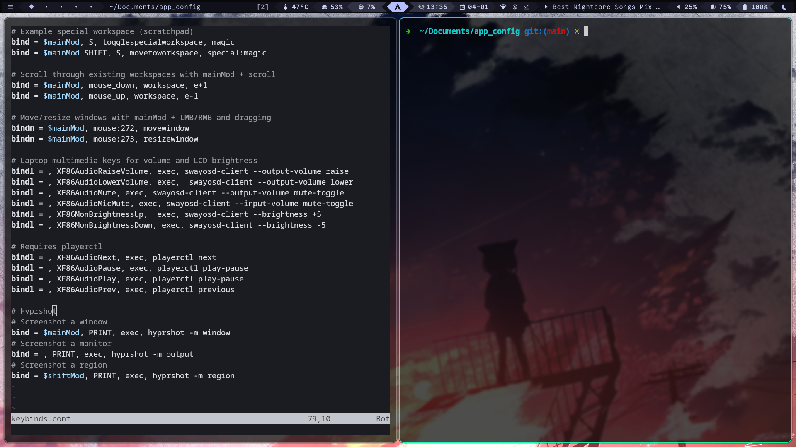
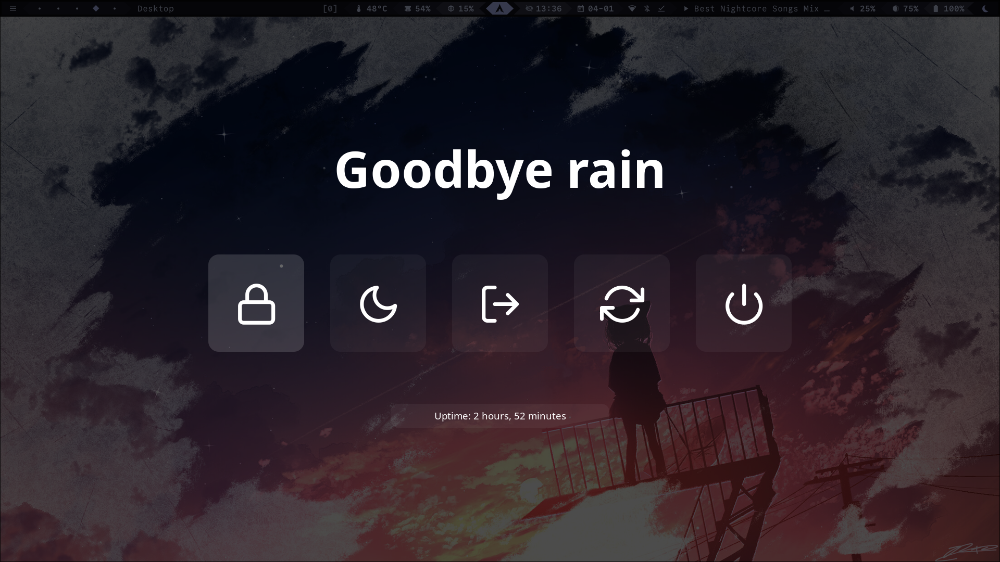

## My configuration for hyprland

### Preview

| | |
|:---:|:---:|
|  |  |
|  |  |

### Packages
- **Window Manager:** [Hyprland](https://hyprland.org/)
- **Terminal:** [Kitty](https://sw.kovidgoyal.net/kitty/)
- **Shell:** [Zsh](https://www.zsh.org/)
- **Status Bar:** [Waybar](https://github.com/Alexays/Waybar)
- **File Manager:** [Dolphin](https://apps.kde.org/dolphin/) & [Yazi](https://github.com/sxyazi/yazi)
- **App Launcher:** [Rofi (Wayland)](https://github.com/davatorium/rofi)
- **Wallpaper:** [swww](https://github.com/L_S_D/swww)
- **OSD:** [SwayOSD](https://github.com/ErikReider/SwayOSD)
- **Idle & Lock:** [hypridle](https://github.com/hyprwm/hypridle) & [hyprlock](https://github.com/hyprwm/hyprlock)
- **Input Method:** [Fcitx5](https://fcitx-im.org/wiki/Fcitx_5)
- **Others:** `playerctl`, `hyprshot`, `firefox`

### Installation
Clone the repository and copy the configuration files:
```bash
# Copy config folders to ~/.config
cp -r config/*/ ~/.config/

# Copy .zshrc to home directory
cp config/.zshrc ~/
```

### Keybindings
| Key | Action |
| --- | --- |
| `Super` + `Enter` | Open Terminal (Kitty) |
| `Super` + `Q` | Close active window |
| `Super` + `E` | Open File Manager |
| `Super` + `V` | Toggle floating window |
| `Super` + `A` | Open App Launcher (Rofi) |
| `Super` + `B` | Open Browser (Firefox) |
| `Super` + `X` | Open Power Menu |
| `Super` + `Arrow` | Move focus |
| `Super` + `1-0` | Switch workspace |
| `Print` | Screenshot monitor |
| `Super` + `Print` | Screenshot window |
| `Shift` + `Print` | Screenshot region |

### Credits
- **Theme:** [Catppuccin Mocha](https://github.com/catppuccin/catppuccin)

